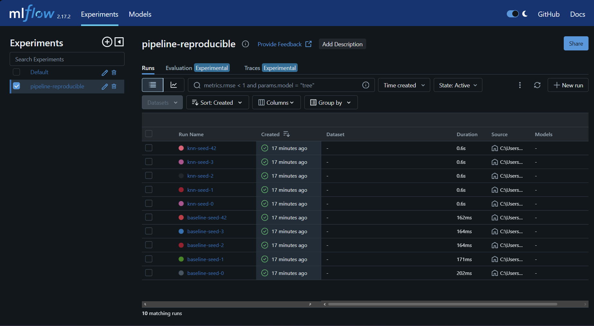

# Pipeline reproducible de ML · SentryBox

Machine Learning I · Proyecto Integrador · Entregable individual  
**Estudiante:** Giancarlo Stefano Neyra Santa Cruz · **Grupo:** Equipo 1 · **GitHub:** Neyrus110  
**Modelo configurado:** KNN para regresión, con 5 vecinos. **Asignación pendiente de confirmar con la docente:** según el orden de integrantes en el informe disponible, al quinto integrante le corresponde SVR; se está usando KNN por indicación del estudiante.

SentryBox estudia la estimación de la **ganancia neta mensual**, en soles, de trabajadores independientes y empleadores del comercio minorista. El archivo compartido por el grupo es un subconjunto de la **ENAHO 2025, módulo 500, del INEI**: contiene 4 765 filas y 18 columnas. Se compara KNN con un baseline que predice la mediana. La métrica principal es el error absoluto medio (MAE, en soles); se informan también RMSE y R².

## Cómo reproducir

Entorno local: **Python 3.11.18, Windows 11 Home**. Las versiones de las cuatro bibliotecas solicitadas y SQLAlchemy (necesaria para la compatibilidad de MLflow) se fijan en `requirements.txt`. Ejecutar los comandos desde la raíz del repositorio. Sustituir `URL_DEL_REPOSITORIO` por su enlace público una vez creado.

La ejecución que produjo los resultados mostrados se hizo en Windows. Para la prueba del extraño se recomienda Windows mientras se consulta con la docente cómo resolver la diferencia entre sistemas: el CSV processed puede generarse con finales de línea CRLF en Windows y LF en macOS/Linux, lo que cambia su MD5 aunque sus datos sean iguales. Por ello no se ha comprobado la igualdad exacta del JSON entre sistemas.

Windows (PowerShell):

```powershell
git clone URL_DEL_REPOSITORIO repro
cd repro
python -m venv .venv
.\.venv\Scripts\Activate.ps1
python -m pip install -r requirements.txt
$env:PYTHONHASHSEED = "0"
python -m src.prepare_data
python -m src.train --seed 42
python -m src.run_seeds
```

macOS / Linux:

```bash
git clone URL_DEL_REPOSITORIO repro
cd repro
python3 -m venv .venv
source .venv/bin/activate
python -m pip install -r requirements.txt
PYTHONHASHSEED=0 python -m src.prepare_data
PYTHONHASHSEED=0 python -m src.train --seed 42
PYTHONHASHSEED=0 python -m src.run_seeds
```

Para consultar las corridas registradas localmente: `mlflow ui --backend-store-uri sqlite:///mlflow.db` y abrir `http://127.0.0.1:5000`. El archivo local `mlflow.db` no se sube al repositorio.

## Resultado esperado

Salida JSON con `--seed 42`:

```json
{"seed":42,"modelo":"knn","data_md5":"f2a07a276a13ca7f0272aa8d8004b2df","mae_mean":583.99904,"mae_sd":32.0252,"rmse_mean":1092.08786,"rmse_sd":112.11172,"r2_mean":0.14867,"r2_sd":0.0574}
```

La ejecución con semilla 42 se repitió tres veces en el entorno local y produjo la misma salida. La siguiente tabla reproduce las 10 filas de [results_summary.csv](results/results_summary.csv):

| Semilla | Modelo | MAE media | MAE DE | RMSE media | RMSE DE | R² media | R² DE |
|---:|---|---:|---:|---:|---:|---:|---:|
| 0 | baseline | 631.05946 | 67.27055 | 1232.92013 | 162.79982 | -0.09580 | 0.02177 |
| 1 | baseline | 631.10871 | 40.24476 | 1229.40888 | 193.37736 | -0.10137 | 0.03142 |
| 2 | baseline | 630.98995 | 47.19475 | 1229.18997 | 196.00026 | -0.09816 | 0.01257 |
| 3 | baseline | 630.90287 | 49.57325 | 1230.49517 | 184.42108 | -0.09767 | 0.00586 |
| 42 | baseline | 631.32751 | 26.57029 | 1238.08550 | 100.72041 | -0.09552 | 0.01312 |
| 0 | knn | 588.70408 | 51.01647 | 1097.72073 | 133.65540 | 0.12869 | 0.05049 |
| 1 | knn | 595.43817 | 27.45672 | 1101.84376 | 180.72692 | 0.11578 | 0.04771 |
| 2 | knn | 587.93190 | 46.44888 | 1096.48176 | 172.08563 | 0.12452 | 0.04764 |
| 3 | knn | 584.52698 | 32.05842 | 1098.16247 | 161.80069 | 0.12483 | 0.02778 |
| 42 | knn | 583.99904 | 32.02520 | 1092.08786 | 112.11172 | 0.14867 | 0.05740 |

En cada fila, las medias y desviaciones estándar (DE) corresponden a los cinco folds de esa semilla. El **resultado reportado**, calculado a partir de las cinco medias de MAE y su DE muestral entre semillas, es **baseline: S/ 631.0777 ± 0.1597** y **KNN: S/ 588.1200 ± 4.5778**. Estas DE entre semillas son distintas de las DE entre folds de la tabla.

Captura de las diez corridas registradas en MLflow:



## Estructura de datos

| Zona | Carpeta | Contenido | Regla |
|---|---|---|---|
| raw (bronze) | `data/raw/` | CSV del subconjunto entregado por el grupo | Se conserva sin editar. Es un archivo derivado, no el archivo original completo del INEI. |
| processed (silver) | `data/processed/` | Datos preparados | Se regenera con `python -m src.prepare_data`. |
| results (gold) | `results/` | Métricas por modelo y semilla | Se regenera con `python -m src.run_seeds`. |

El origen conocido, los hashes, el diccionario y las condiciones pendientes se documentan en [el manifiesto](data/MANIFIESTO.md). Debe confirmarse la licencia o las condiciones de redistribución antes de publicar el CSV.

## Qué lo hace reproducible

| Requisito | Cómo se cumple o qué falta |
|---|---|
| Historial de al menos 6 commits | **Pendiente:** registrar los cambios de forma auténtica durante el desarrollo y publicar el historial. |
| Sin fuga de datos | El 20 % se reserva con la semilla fija 42. La imputación, el escalamiento y la codificación se ajustan dentro del `Pipeline` en cada fold del 80 % restante. |
| Aleatoriedad fija | La partición usa la semilla 42; la validación cruzada usa las semillas 0, 1, 2, 3 y 42. `PYTHONHASHSEED` se fija antes de iniciar Python. |
| Cinco semillas en MLflow | Se ejecutaron cinco corridas para el baseline y cinco para KNN; el script calcula media y desviación estándar muestral del MAE entre semillas. La captura se encuentra en `docs/mlflow.png`. |
| Mismos datos para todos | El grupo debe confirmar que usa el mismo archivo y comparar el MD5 de `processed`; la partición también debe mantenerse igual. |
| Entorno exacto | Python 3.11.18 y las versiones fijadas en `requirements.txt`. La corrida de semilla 42 se repitió tres veces con la misma salida. Una clonación local en Windows y un entorno virtual nuevo reprodujeron la salida y el CSV de las diez corridas. Falta la prueba independiente de un compañero. |

## Prueba del extraño

**Pendiente.** Un compañero de otro grupo debe clonar el repositorio sin ayuda, ejecutar los pasos en un entorno nuevo y abrir un Issue con su salida y si coincide. Completar aquí su nombre, grupo, enlace al Issue y resultado real.

## Limitaciones

La ganancia es autorreportada y puede contener errores o subdeclaración. La muestra abarca el Perú, no solo Lima; no se usan factores de expansión, por lo que los resultados describen la muestra. Se excluyeron personas con ganancia no informada o no positiva al construir el subconjunto. El objetivo es ganancia, no riesgo de impago. La fecha de descarga, la URL directa de la fuente y las condiciones de redistribución están pendientes de confirmación. Las variables reflejan características personales y socioeconómicas; sus efectos deben evaluarse antes de cualquier uso para decisiones crediticias. La diferencia de finales de línea entre sistemas puede cambiar el MD5 de processed, aunque los datos sean iguales; está pendiente consultar la solución con la docente.

## Respuestas

1. **¿Por qué el imputador y el escalador están dentro del Pipeline y no se aplican a todo el dataset antes de la validación cruzada?**  
   Porque en cada fold las medianas y los parámetros de escala se calculan solo con los datos de entrenamiento de ese fold. Si se calcularan con todo el dataset, incluso las observaciones de validación influirían en la preparación y el MAE podría parecer más favorable de lo que corresponde. En SentryBox esto afecta, por ejemplo, a la imputación y el escalamiento de edad y horas trabajadas.

2. **¿Por qué el 20 % de prueba no se usa en este entregable? ¿Qué pasaría con su resultado si lo usara para elegir el modelo?**  
   Se reserva para evaluar al final el modelo elegido por el grupo con observaciones que no intervienen en su selección. Si elegimos el modelo en función del desempeño en esa prueba, adaptamos indirectamente la elección a esos datos y la estimación final puede ser optimista. Aquí la comparación se realiza mediante validación cruzada únicamente sobre el 80 % restante.

3. **¿Qué mide la desviación estándar entre las 5 semillas y qué NO mide?**  
   Mide cuánto cambia el MAE medio de validación cruzada al cambiar la división del 80 % de entrenamiento en cinco folds. No mide directamente la incertidumbre poblacional, el error del 20 % reservado, ni garantiza el desempeño con datos nuevos. La partición 80/20 permanece fija: cambian las divisiones internas de validación cruzada.

4. **¿Su modelo supera al baseline en las 5 semillas? ¿La diferencia es mayor que la desviación estándar? ¿Qué concluye?**  
   Sí. KNN tiene menor MAE que el baseline en las cinco semillas. Entre semillas, el MAE medio es S/ 588.1200 frente a S/ 631.0777: la diferencia es aproximadamente S/ 42.96, mayor que las DE de ambos modelos (S/ 4.5778 y S/ 0.1597). En esta validación cruzada KNN supera al baseline; el resultado no sustituye la evaluación final con el 20 % reservado.

5. **¿Por qué el archivo de la zona raw no se modifica nunca y para qué sirve su MD5?**  
   Mantener intacto el CSV recibido permite volver a generar los datos preparados y rastrear de qué entrada proceden. El MD5 permite comprobar si dos archivos coinciden byte a byte con el identificador registrado; también ayuda al grupo a detectar cambios accidentales. El raw disponible es el subconjunto del grupo, no el archivo original completo del INEI.

6. **¿Por qué PYTHONHASHSEED=0 debe definirse antes de iniciar Python y no dentro del script?**  
   Porque el intérprete configura la semilla de hash al arrancar. Asignar la variable después de iniciado el proceso no cambia esa configuración de la ejecución actual. Fijarla antes ayuda a estabilizar operaciones que dependen del orden de estructuras basadas en hash; por eso se establece en la terminal antes de ejecutar cada comando.

## Declaración de uso de IA

Se utilizó **OpenAI Codex** como apoyo para revisar la plantilla, organizar el repositorio y redactar documentación y código. **Pendiente de completar por el estudiante:** indicar qué partes revisó, comprendió y ejecutó personalmente antes de entregar. El autor es responsable del contenido y debe poder explicar el código y sus decisiones.
